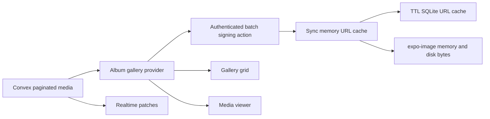

# Instant Album Navigation

## Architecture

The implementation will use stale-while-revalidate semantics: cached album metadata, signed URLs, and decoded image bytes remain visible while Convex subscriptions and expiring signatures refresh in the background. A loading shell is used only when no prior data exists.

## Backend: Convex and Cloudflare signing

- Add a bounded, authenticated batch media-delivery action (maximum one media page, currently 60) that accepts `albumId` plus Convex media IDs, resolves those IDs server-side, verifies they all belong to the requested album, checks membership once, and returns `{ mediaId, kind, url, expiresAt }` with explicit argument/return validators.
- Refactor signing helpers from [packages/backend/convex/r2.ts](packages/backend/convex/r2.ts) and [packages/backend/convex/cloudflare.ts](packages/backend/convex/cloudflare.ts) so the batch endpoint can sign mixed R2 images and Stream thumbnails without duplicating keys or JWT logic. Retain on-demand signed Stream playback for videos.
- Add a thin internal query in [packages/backend/convex/media.ts](packages/backend/convex/media.ts) to resolve/validate requested media using the existing `by_albumId` index. Do not trust client-supplied R2 keys or Stream UIDs.
- Keep [packages/backend/convex/schema.ts](packages/backend/convex/schema.ts) unchanged: existing media identifiers and indexes are sufficient, so there is no migration or stored signed-URL data.
- Preserve current privacy semantics from [CONTEXT.md](CONTEXT.md): gallery image/video delivery is membership-gated; album covers and avatars remain publicly resolvable but are still delivered by expiring signed URLs.

## Frontend: shared realtime album state

- Restructure the album route into a nested layout (`album/[id]/_layout.tsx` plus `index.tsx`) and introduce an album-scoped provider so the detail grid and media viewer share one `usePaginatedQuery` subscription, loaded pages, pending uploads, and delivery-prefetch state instead of starting a second first-page query.
- Keep pagination at 60 items and preserve `CanLoadMore`/`LoadingMore` behavior in [apps/expo/src/hooks/useAlbumMedia.ts](apps/expo/src/hooks/useAlbumMedia.ts); realtime Convex results remain the source of truth and no TanStack Query mirror will be added.
- Merge the currently disconnected optimistic upload state into the shared album media result so pending uploads continue to appear consistently without replacing server pages.
- Add a small display-only last-known album snapshot cache populated from the albums list. [apps/expo/src/app/(home)/album/[id]/index.tsx](apps/expo/src/app/(home)/album/[id]/index.tsx) will render that snapshot during a warm query handoff rather than replacing the screen with a full-screen spinner.

## Frontend: signed URL and byte caching

- Replace [apps/expo/src/hooks/useSignedUrls.ts](apps/expo/src/hooks/useSignedUrls.ts), the unused cache plumbing in [apps/expo/src/hooks/useCache.ts](apps/expo/src/hooks/useCache.ts), and the separate cover cache with one typed media-delivery cache:
  - synchronous in-memory entries for zero-frame warm remounts;
  - SQLite persistence with an expiry safety margin below the one-hour signature lifetime;
  - in-flight request deduplication and page-level batch fills;
  - distinct purposes for gallery/viewer images, video thumbnails/playback, and covers;
  - stale-image retention while signatures refresh;
  - eviction and one-time re-sign/retry on 401/403 or image load failure.
- Drive batch signing from the album provider whenever a Convex page arrives, then prefetch visible and near-future assets through `expo-image`. Keep stable `cacheKey`/`recyclingKey` values based on media identity so changing signed query strings do not invalidate local image bytes.
- Update [apps/expo/src/components/gallery/gallery-tile.tsx](apps/expo/src/components/gallery/gallery-tile.tsx), [apps/expo/src/components/gallery/viewer-item.tsx](apps/expo/src/components/gallery/viewer-item.tsx), album cards, and gallery headers to retain the last bitmap or a stable skeleton instead of swapping to activity indicators. Disable warm-cache fade transitions and prefetch neighboring viewer items.
- Keep video playback on demand and signed; unify its TTL storage with the new cache rather than maintaining a separate AsyncStorage path.

## Tests, documentation, and verification

- Add frontend tests for synchronous warm-cache rendering, SQLite expiry, in-flight deduplication, batch hydration, failed-signature retry, shared grid/viewer pagination, and preservation of the existing 60-item paging contract.
- Add backend-focused tests around media-ID ownership validation, membership denial, mixed image/video response mapping, batch bounds, and validator-compatible return shapes; retain existing gallery/layout tests.
- Add [docs/architecture/media-delivery.md](docs/architecture/media-delivery.md) documenting data flow, privacy boundaries, TTLs, cache invalidation, pagination, failure behavior, and operational tradeoffs. Include direct official references:
  - [Convex pagination](https://docs.convex.dev/database/pagination)
  - [Convex actions](https://docs.convex.dev/functions/actions)
  - [Cloudflare R2 presigned URLs](https://developers.cloudflare.com/r2/api/s3/presigned-urls/)
  - [Cloudflare Stream signed URLs](https://developers.cloudflare.com/stream/viewing-videos/securing-your-stream/)
  - [Expo Image caching and prefetch](https://docs.expo.dev/versions/latest/sdk/image/)
  - [Expo SQLite](https://docs.expo.dev/versions/latest/sdk/sqlite/)
- Verify with Expo Jest suites, Expo lint, backend/frontend TypeScript checks, generated Convex types, and `npx convex dev --once` against the development deployment. Preserve unrelated existing working-tree changes and report any pre-existing failures separately.