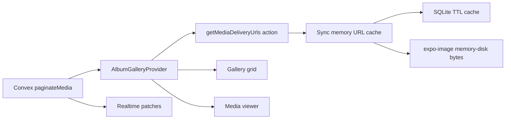

# Media delivery architecture

Shutterspace serves collaborative album media with two layers:

1. **Convex** — realtime metadata (albums, media rows, membership, pagination)
2. **Cloudflare** — private bytes (R2 images, Stream video), always via **short-lived signed URLs**

This document describes how the client avoids 100–200ms loading flashes when navigating back to screens whose data was already fetched.

## Goals

- Paint last-known album chrome and gallery tiles immediately on warm navigation
- Keep Convex as the source of truth for object data (no TanStack Query mirror)
- Sign every Cloudflare asset; never trust client-supplied R2 keys / Stream UIDs
- Preserve privacy: gallery delivery is membership-gated; covers remain publicly resolvable but still signed

## Data flow

### Warm navigation rule

Never blank a screen that has been shown before:

| Layer | Warm behavior |
|---|---|
| Album metadata | `albumSnapshotCache` + live `useQuery` |
| Signed URLs | sync memory map → SQLite → batch/action refresh |
| Image bytes | `expo-image` `cacheKey` / `memory-disk` |

A full-screen spinner is only for cold start (no snapshot and no Convex result yet).

## Backend

### Batch signing

- Public action: `mediaDelivery.getMediaDeliveryUrls`
- Args: `{ albumId, mediaIds }` (max **60**, matching gallery page size)
- Steps:
  1. Membership check once
  2. `media.resolveMediaForDelivery` loads rows by ID and verifies `media.albumId === albumId`
  3. Signs R2 GETs / Stream thumbnail JWTs in parallel
  4. Returns `{ mediaId, kind, url, expiresAt }[]`

Cross-album IDs throw — the client cannot mint URLs for media it only knows by opaque ID from another album.

Video **playback** remains on-demand via `cloudflare.getVideoPlaybackURL` (still membership-gated).

### Privacy

| Asset | Auth | Notes |
|---|---|---|
| Gallery image / video thumb / playback | Album member | Batch or single signed URL |
| Album cover | Public (signed) | Intentional list/invite surface |
| Avatar | Public bucket | Profile pictures |

### TTL

Signed URLs expire in **1 hour** (`MEDIA_DELIVERY_URL_TTL_SECONDS = 3600`).  
Client SQLite / memory caches use a **55 minute** safety margin and refresh before expiry.

## Frontend

### Shared album state

`AlbumGalleryProvider` (`album/[id]/_layout.tsx`) owns:

- one `usePaginatedQuery(api.media.paginateMedia)` (page size 60)
- live `queryAlbum` with snapshot fallback
- pending uploads from Zustand
- page-level `getMediaDeliveryUrls` hydration + `expo-image` prefetch

The album layout wraps a **nested native `Stack`** (not `Slot`) so `Stack.Toolbar` / headers keep working for album → media. The parent `(home)` stack hides its header for `album/[id]`; the album index root shows an explicit back control that calls `router.back()` to pop the parent (albums → album). Media → album back is automatic inside the nested stack.

Grid and viewer both call `useAlbumGallery()` — the viewer does not start a second first-page subscription.

### Delivery cache

`apps/expo/src/lib/mediaDeliveryCache.ts`:

- `getDeliveryUrlSync` for zero-frame remounts
- `ensureDeliveryUrl` with in-flight dedupe
- `applyDeliveryBatch` after provider hydration
- `invalidateDeliveryEntry` + re-sign on image load error

Hooks:

- `useMediaDelivery` — tiles / viewer / settings thumbnails
- `useAlbumCover` — list + header covers (same cache, `album_cover` purpose)

### UI policy

- Keep showing the last bitmap while a URL refreshes
- `transition={0}` when a cached URI is present
- Spinner only when there is no URI yet (true cold tile)

## Pagination

- Gallery page size: **60** (`useAlbumMedia`)
- Backend: `paginateMedia` on `by_albumId` desc
- Infinite scroll via FlashList `onEndReached`
- Each new page triggers batch signing for ready media missing fresh URLs

Official docs: [Convex pagination](https://docs.convex.dev/database/pagination)

## Failure behavior

1. Signed URL 401/403 or `expo-image` `onError` → invalidate cache entry → re-batch/re-sign once
2. Membership revoked → batch action throws; UI surfaces existing ConvexError handling
3. Soft-deleted / pending media are skipped by the resolver (no URL minted)

## Operational tradeoffs

- **Pros:** one membership check per page, fewer action round-trips, instant warm remounts
- **Cons:** batch shares a mint clock (URLs on a page expire together); SQLite adds a small disk write per URL
- **Not done here:** Cloudflare CDN caching of private gallery objects (presigned query strings defeat edge cache). Client disk cache is the primary byte cache for private media.

## Official references

- [Convex pagination](https://docs.convex.dev/database/pagination)
- [Convex actions](https://docs.convex.dev/functions/actions)
- [Cloudflare R2 presigned URLs](https://developers.cloudflare.com/r2/api/s3/presigned-urls/)
- [Cloudflare Stream signed URLs](https://developers.cloudflare.com/stream/viewing-videos/securing-your-stream/)
- [Expo Image caching / prefetch](https://docs.expo.dev/versions/latest/sdk/image/)
- [Expo SQLite](https://docs.expo.dev/versions/latest/sdk/sqlite/)
